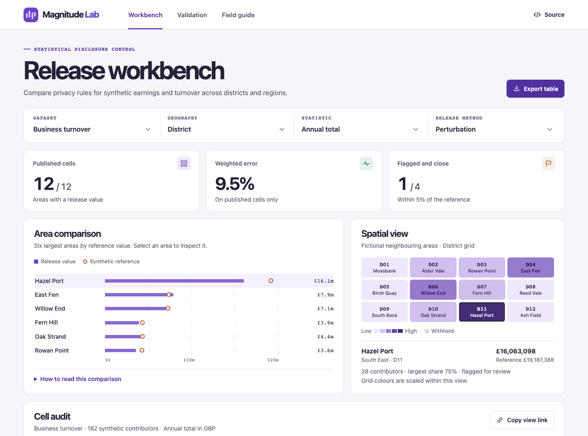

# Magnitude Lab

**Which local statistics remain useful after disclosure controls are applied?** Magnitude Lab is an independent, AI-assisted research demonstration for the Cantabular / Queen’s University Belfast KTP research scientist role. Use the workbench to compare four release policies on fictional household earnings and business turnover.

**[Open the workbench](https://rongsenzhang.github.io/magnitude-lab/)** · [Validation results](https://rongsenzhang.github.io/magnitude-lab/#tab=validation) · [Field guide](https://rongsenzhang.github.io/magnitude-lab/#tab=guide) · [Version 1.0.0](https://github.com/rongsenzhang/magnitude-lab/releases/tag/v1.0.0)



## A three-minute review

1. [Open the combined regional turnover release](https://rongsenzhang.github.io/magnitude-lab/#tab=workbench&dataset=turnover&level=region&metric=sum&method=combined). Select South East. Its 37 businesses might suggest a sufficient sample, but one firm contributes 70.63% of the total. The policy withholds the result. The other regions retain their estimates.
2. [Check the same question across 32 held-out populations](https://rongsenzhang.github.io/magnitude-lab/#tab=validation&dataset=turnover&level=region&metric=sum&method=combined). Only 64 of 128 neighbouring-region comparisons remain available. Of those, 62 retain their original ordering. Accuracy on the surviving comparisons and the cost of losing half the comparisons answer different questions.
3. [Inspect the integration examples](https://rongsenzhang.github.io/magnitude-lab/#tab=guide). Read four historical counts retrieved from Cantabular's public Irish census endpoint. Switch the release profile to see exactly what a downstream client receives for a synthetic magnitude table. These examples use independent sources and show their provenance.

## Research and delivery evidence

| Reviewer question | Evidence |
|---|---|
| What does Cantabular already offer and who provides alternatives? | [Business, customers and technology](docs/company-review.md) · [123 public URLs checked](docs/company-pages.csv) · [Commercial and statistical-service comparison](docs/market.md) |
| Why these methods and how are they measured? | [Technical path](docs/technical-path.md) · [Experimental design, thresholds, sensitivity and spatial effects](docs/methods.md) |
| Can I reproduce the numbers or connect another client? | [Python generator](research/generate.py) · [All comparison data](web/data/lab.json) · [Tested public API and synthetic output profiles](docs/integration.md) |
| How would this become a KTP project? | [Six project stages, ten associate duties, operator training, six-month pilot and benefits evaluation](docs/delivery.md) |

## Reproduce 1.0

Python 3.9 or newer is sufficient for the calculations and the web server. Run from the repository root.

```sh
python3 research/generate.py --check
python3 -m integration.reviewer_bundle --check
python3 -m unittest discover -s tests -v
python3 -m http.server 8000 --directory web --bind 127.0.0.1
```

Open [the local workbench](http://127.0.0.1:8000/). To regenerate the committed results, run `python3 research/generate.py` followed by `python3 -m integration.reviewer_bundle`. The [integration guide](docs/integration.md) includes the optional live query and the client request schema.

For browser tests, use Node.js 20 or newer and npm. The runner starts its own local server at the Pages project subpath.

```sh
npm ci
npx playwright install --with-deps chromium webkit
npm run test:browser
```

On `main`, GitHub Actions checks the generated outputs, runs the Python and browser suites and deploys the tested `web/` directory. The public site runs without a login, API key or application server.

## Interpretation

The synthetic research view deliberately exposes reference values for evaluation. A small-cell or dominance flag and proximity to the reference are diagnostic indicators. They do not quantify individual disclosure risk or provide a formal privacy guarantee. Cantabular has its own magnitude methodology. This independent implementation makes a bounded comparison and reads one publicly available historic count table. Deploying the research method on confidential data, validating it inside a partner instance, and measuring operator or commercial outcomes would require partner participation.
